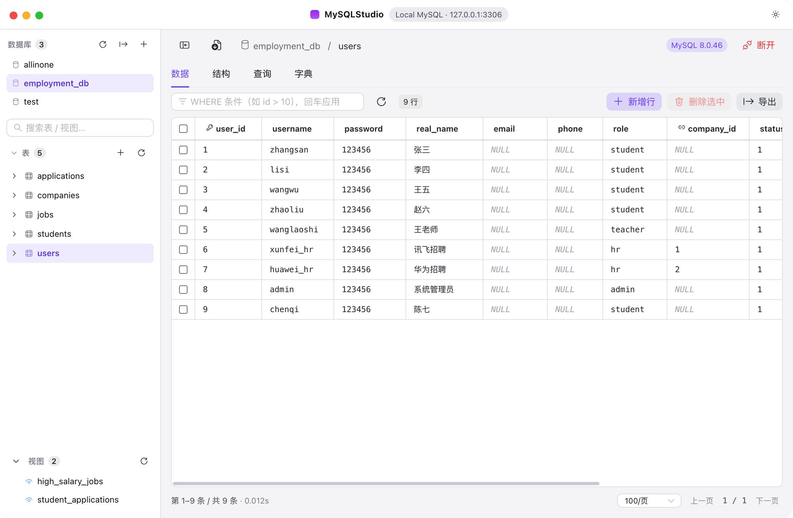
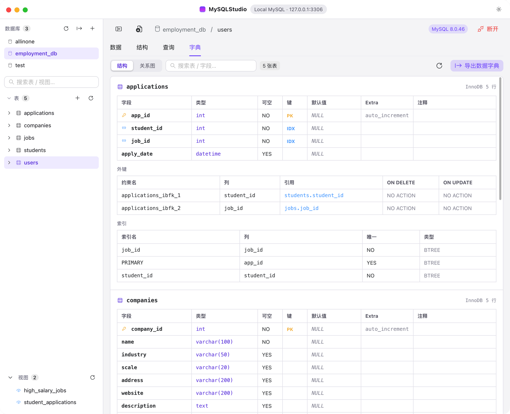
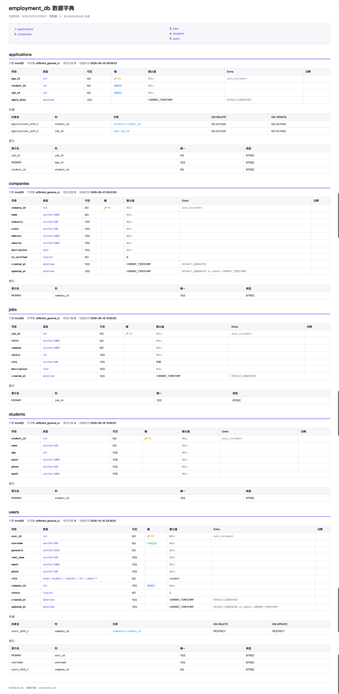

<div align="center">

# MySQLStudio

**一个好看、顺手的跨平台 MySQL 图形客户端**

Electron + Vue 3 + Naive UI + Monaco Editor

[](LICENSE)
[](https://github.com/humbertcheung/MySQLStudio/releases/latest)


[下载安装](#下载安装) · [功能](#功能) · [从源码构建](#从源码构建) · [常见问题](#常见问题)

</div>

---

## 简介

MySQLStudio 是一个面向日常开发与演示场景的 MySQL 桌面客户端：连接管理、库/表/视图浏览、数据增删改查、表结构编辑、外键管理、SQL 编辑器、数据字典与 ER 关系图一应俱全，并针对 macOS 与 Windows 做了原生窗口适配。

- 深色 / 浅色 / 跟随系统 三档主题，暗色为默认
- 表格列宽可拖拽并自动记忆，长文本自动截断 + 悬浮查看
- 所有写操作集中在主进程，渲染进程无 Node 权限（`contextIsolation` + preload 白名单 IPC）

> 本项目仅支持 MySQL / MariaDB，不依赖任何商业客户端代码。



## 界面预览

### 连接管理

支持多连接、记住密码、连接测试，配置保存在本地。


### 表数据浏览与编辑

分页、排序、WHERE 筛选、双击编辑、批量删除、导出，列宽可拖拽并记忆。


### 数据字典 · 结构视图

按表展示字段、外键与索引，支持搜索与一键导出。



### 数据字典 · ER 关系图

按外键引用分层排布，展示全部字段，卡片可拖拽、位置可重置。


### 导出的 HTML 数据字典

一键导出可离线阅读的 HTML（同时支持 Markdown / CSV），含索引与外键信息。



## 项目结构

```
src/
├─ main/index.js         主进程：连接池、全部 IPC handler、窗口
├─ preload/index.js      contextBridge 白名单 API（统一清洗 IPC 参数）
└─ renderer/             Vue 3 渲染层
   ├─ App.vue            标题栏与主题
   ├─ store.js           全局状态
   ├─ styles.css         设计系统 token（双主题）
   └─ components/        Sidebar / DataPane / StructurePane / QueryPane
                         DictionaryPane / ErDiagram / ResultSetView …
build/                   图标与安装说明
electron-builder.yml     DMG / NSIS / portable 打包配置
```

## 下载安装

前往 [Releases](https://github.com/humbertcheung/MySQLStudio/releases/latest) 下载对应平台安装包：

| 平台 | 文件 | 说明 |
| --- | --- | --- |
| macOS 13+ | `MySQLStudio-2.0.0-universal.dmg` | Universal（Apple Silicon + Intel），已使用 Developer ID 签名并通过 Apple 公证，双击即可安装 |
| Windows 10/11 x64 | `MySQLStudio-2.0.0-win-x64.exe` | NSIS 安装向导，默认按当前用户安装，无需管理员权限 |
| Windows 10/11 x64 | `MySQLStudio-2.0.0-portable-x64.exe` | 免安装单文件，双击即用，可放 U 盘 |

**Windows 首次运行提示**：安装包未购买 Windows 代码签名证书，SmartScreen 会显示「Windows 已保护你的电脑」——点「更多信息 → 仍要运行」即可，这不是病毒。

更多细节见 [macOS 安装说明](build/安装说明.txt) 与 [Windows 安装说明](build/安装说明-Windows.txt)。

## 功能

### 连接
- 多连接配置，支持记住密码（可关闭）
- 密码显示/隐藏、连接测试
- 连接配置持久化到本地，重启自动带出

### 数据
- 表数据分页浏览，支持排序、WHERE 条件筛选
- 双击单元格编辑：失焦后浮出「保存 / 取消」，`NOT NULL` 列空值自动拦截
- 新增行、删除行（基于主键）
- 当前结果集导出 CSV / JSON / SQL
- 整库导出：仅结构（schema）或 结构 + 数据（含视图），生成可直接执行的 `.sql`

### 结构
- 列定义查看与编辑（类型、长度、默认值、注释、可空、自增）
- 添加 / 修改 / 删除 / 重命名列
- 索引与外键的查看、新增、编辑、删除

### 查询
- Monaco 编辑器：SQL 语法高亮、自动补全、`⌘/Ctrl + Enter` 执行
- 多语句执行、多结果集切换
- 查询历史、当前库切换

### 数据库与表管理
- 数据库列表支持刷新、右键编辑（字符集/排序规则）、删除
- 表右键菜单：查看数据 / 结构、导出结构、导出结构+数据、重命名、清空、删除
- 视图浏览
- SQL 文件导入

### 数据字典
- 全库字段字典，一键生成
- ER 关系图：按引用关系分层布局，展示全部字段，卡片可拖拽、可重置位置
- 导出 HTML / Markdown / CSV

## 从源码构建

要求：Node.js 20+、npm 10+

```bash
git clone https://github.com/humbertcheung/MySQLStudio.git
cd MySQLStudio
npm install
npm run dev          # 开发模式（热更新）
```

### 打包

```bash
npm run dist:mac            # macOS universal DMG（需在 macOS 上执行）
npm run dist:win            # Windows x64 NSIS 安装包（可在 macOS 上交叉构建）
npm run dist:win:portable   # Windows x64 免安装单文件
```

macOS 签名使用 electron-builder 自动发现的 Developer ID 证书：

```bash
# 公证（需提前执行 xcrun notarytool store-credentials <profile>）
xcrun notarytool submit release/MySQLStudio-2.0.0-universal.dmg --keychain-profile <profile> --wait
xcrun stapler staple release/MySQLStudio-2.0.0-universal.dmg
```

Windows 签名需提供 `CSC_LINK` / `CSC_KEY_PASSWORD`（PFX 证书），未提供时 electron-builder 会自动跳过签名。

## 数据与安全

连接配置（含密码）保存在：

- macOS：`~/Library/Application Support/MySQLStudio/connections.json`
- Windows：`%APPDATA%\MySQLStudio\connections.json`

⚠️ **密码以明文 JSON 保存在本地**。这与你选择的「记住密码」选项直接相关；在共享设备上建议关闭「记住密码」。应用不会向任何第三方发送连接信息或查询内容。

## 技术栈

| 层 | 选型 |
| --- | --- |
| 桌面框架 | Electron 33 |
| 渲染层 | Vue 3 + Vite（electron-vite） |
| 组件库 | Naive UI + @vicons/fluent |
| SQL 编辑器 | Monaco Editor |
| 数据库驱动 | mysql2（连接池，utf8mb4） |
| 打包 | electron-builder（DMG / NSIS / portable） |

## 常见问题

**Q：连接失败 `Access denied`？**
A：确认用户名/密码与来源主机权限；MySQL 8 的 `caching_sha2_password` 已支持。

**Q：中文乱码？**
A：连接固定使用 `utf8mb4`；若仍乱码请检查库/表/列的字符集。

**Q：Windows 上字体发虚？**
A：高 DPI 缩放下可在「属性 → 兼容性 → 更改高 DPI 设置」勾选「替代高 DPI 缩放行为（系统）」。

**Q：ER 图卡片被拖乱？**
A：点「重置位置」恢复自动布局，重启应用也会重置。

## License

[MIT](LICENSE) © 2026 Humbert Cheung

本项目为独立实现，与 TablePlus、Navicat 等商业软件无任何关联。
